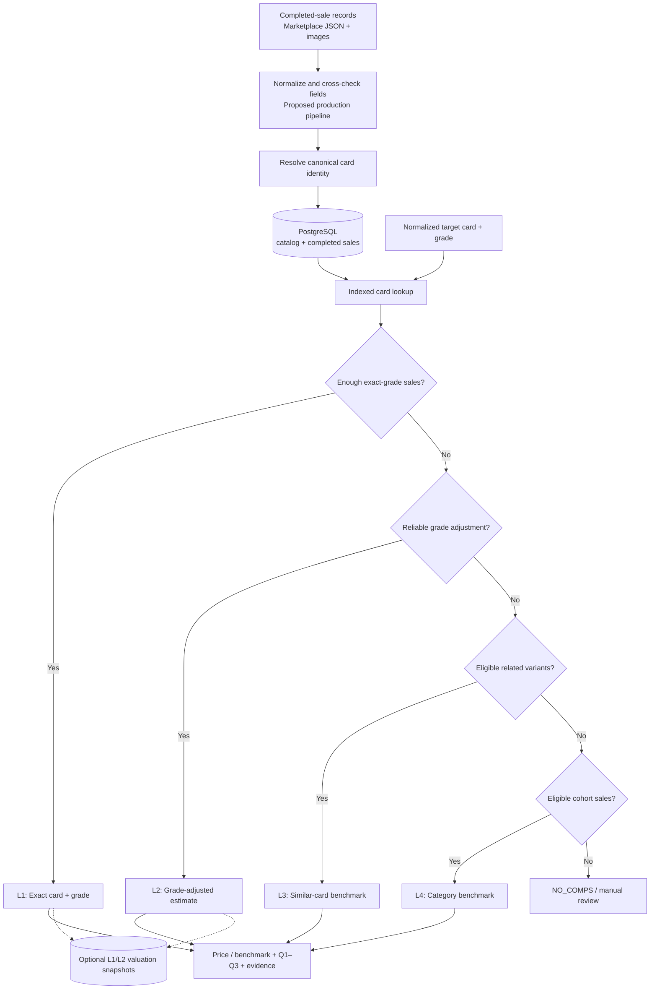

# Trading Card Market Valuation System

**PostgreSQL + Python | Proof of Concept | Historical Sales–Based Pricing**

A proof of concept for grouping completed trading-card sales under consistent card identities and producing explainable market estimates. The system prioritizes sales of the **exact card variant and grade**, then progressively searches for weaker—but potentially useful—comparable evidence when exact sales are scarce.

> **Project scope:** This is a research and engineering prototype developed with **10,000 synthetic completed-sale records**, not a production appraisal service. Marketplace integration, image verification, and real-world pricing accuracy have not been established.

## 1. Problem and approach

Marketplace listings may describe the same trading card differently, while apparently similar cards can have different market values due to parallel colors, print runs, image variations, autographs, relics, and condition/grade. The two primary challenges are:

1. **Identity resolution:** Assign multiple sales of the same card variant to a consistent internal identity.
2. **Valuation:** Retrieve appropriate historical comparables and calculate an estimate—or a clearly labeled benchmark—when evidence is sparse.

The system is designed around **offline ingestion → canonical identity → indexed retrieval → hierarchical valuation**. The same architecture could support interactive price lookups and nightly inventory repricing. A **200–500 ms** lookup time is a design target discussed for the production system, **not a measured prototype result**.

### Architecture



**Implementation boundary:** The current prototype implements the database, canonical identity assignment from normalized input, retrieval, and L1–L4 pricing logic. The marketplace/image normalization and cross-checking stage above describes the **proposed** production pipeline and is **not implemented**.

## 2. Assumptions and data acquisition

- **No company historical-sale feed was available** for this exercise. I explored eBay listing/item-specific fields and historical-sale sources, then generated **10,000 reproducible synthetic completed sales** for demonstration.
- Every input transaction represents a **completed sale**, not a seller's active asking price. Records contain source transaction ID, sale date, price, card attributes, and grade/condition.
- The prototype assumes **normalized, upstream-verified identity attributes**. Incomplete required fields fail validation; a production pipeline should retain and route unresolved records for review.
- The demo's explicit `null` print-run limit represents a known **unnumbered** card, not an unknown value. A production system must preserve that distinction.
- No synthetic card or price is evidence that a real manufacturer produced that exact card or that the price reflects the market.

### Proposed real-world ingestion and verification

1. **Marketplace JSON:** Ingest authorized completed-sale feeds or exports, retaining source IDs, item-specific attributes, title, sale price/date, currency, images, and original JSON for traceability. eBay active listings alone are not proof of completed sales; historical-sale access can be restricted.
2. **Image-to-text:** Use the existing picture-to-text pipeline discussed during the interview to extract visible player, set, number, color/parallel, and grade details. Compare these with the marketplace JSON; corroborate missing attributes or flag disagreements (e.g., listing says Green but image suggests Orange).
3. **Independent reference checks (future):** Where available, compare the combination of attributes against manufacturer checklists and grading/certification records. Image agreement or a certificate number is **supporting evidence**, not a guarantee of authenticity.

These production validation stages are **design proposals**; the executable demo starts from normalized synthetic JSON.

## 3. Database design and canonical identifiers

The PostgreSQL schema (`schema.sql`) has five tables:

| Table | Responsibility |
|---|---|
| `players` | Canonical athlete identities. |
| `card_sets` | Manufacturer product sets, including sport and year. |
| `card_variants` | One record per distinct printed variant; contains `card_id`, `canonical_key`, `group_key`, `cohort_key`, and card-defining attributes. |
| `completed_sales` | Individual sold transactions, grade/condition, date, USD price, source ID, and original JSON; many sales can share one `card_id`. |
| `valuation_snapshots` | Optional derived estimate, observed Q1–Q3 band, method, grade, evidence count, and calculation date. |

**Exact identity:** A deterministic SHA-256 `canonical_key` is calculated from normalized set, player, card number, parallel, print-run limit, image/back variations, autograph, and relic attributes. PostgreSQL also creates an integer `card_id` for efficient joins. **Grade is stored with the sale, not embedded in the card identity**, because one variant may be sold raw, PSA 9, or PSA 10.

**Broad retrieval groups:**

- `group_key = sport:year:manufacturer:player` — retrieve same-player candidates, including related variants.
- `cohort_key = sport:year:manufacturer` — broaden to other players within the general category.
- Card number is intentionally absent from these nonunique grouping keys; exact-card identity still includes it.

The ingestion script finds or creates the player, set, and card variant, then links the sale to its `card_id`. `(source, external_sale_id)` prevents duplicate inserts **within each source**. The catalog is searched before the much larger sales table, and indexes support exact lookups by `(card_id, grade_bucket, sold_at)` and broader candidate search by grouping keys. Cross-provider deduplication remains future work.

## 4. Retrieval and pricing hierarchy

Each stage searches the **last 90 days**, extending to **180 days** at the same stage if necessary before moving to weaker comparables.

| Level | Selection logic | Calculation and interpretation |
|---|---|---|
| **L1 · Exact card + grade** | Same `card_id` and grade; at least **3 sales**. | Median of completed-sale prices; observed Q1–Q3. **HIGH** with ≥5 sales, **MEDIUM** with 3–4 (prototype policy). |
| **L2 · Same card, different PSA grade** | At least **3 reference-grade sales**; estimate a grade conversion using **≥5 other card variants** with sales at both grades. No raw↔PSA conversion. | Compute `median(target-grade prices) / median(reference-grade prices)` for each paired card variant; take the **median of these ratios**. Multiply reference-grade sale prices by that factor; report median and Q1–Q3. **MEDIUM**, modeled estimate. |
| **L3 · Same player, related variant** | Same set and grade; autograph, relic, image variation, and back variation must match. Parallel color may differ; numbered print-run ratio must be **0.25×–2×**; at least **3 sales**. | Take each eligible variant's sale-price median, then the median across variants. Q1–Q3 across variants only when more than one comparable variant exists. **LOW**; indicative similar-card benchmark. |
| **L4 · Other players, same card category** | Different player; same set, grade, parallel, print run, autograph, relic, image, and back variation; at least **3 sales**. | Median of per-variant medians, with Q1–Q3 across variants. **VERY LOW**; category benchmark **not a target-card value**. Requires human review. |

If no stage has adequate evidence, the system returns **`NO_COMPS`** rather than inventing a value. L3/L4 are descriptive benchmarks, **not automatic purchase prices or inventory repricing recommendations**.

### Why median and IQR?

The **median** is less sensitive to extreme sale prices than the arithmetic mean. **Q1–Q3** (25th–75th percentiles) describes the middle half of the observed comparable values, not a predicted target price interval or statistically calibrated confidence interval. For L2, it also **does not account for uncertainty in the grade-conversion multiplier**. Confidence is reported separately.

### Demonstration results (synthetic data only)

| Scenario | Method | Center | Q1–Q3 | Evidence |
|---|---|---:|---:|---|
| Exact PSA 9 | L1 | **$125.00** | $119.00–$130.00 | 7 sales; HIGH |
| PSA 10 → PSA 9 | L2 | **$126.01** | $121.32–$132.71 | 6 sales; factor ≈0.54 from 23 paired variants |
| Related parallel | L3 | **$175.00** | Not available | 5 sales from 1 alternative variant; LOW |
| Other-player cohort | L4 | **$251.41** | $178.32–$330.08 | 41 sales, 18 variants; category benchmark only |

These outputs show algorithm behavior on fictional data; they do **not** validate real-world price accuracy.

## 5. Run the prototype

**Prerequisites:** Python **3.10+** and PostgreSQL **14+**. pgAdmin 4 is optional for creating/querying the database; Docker is also optional. Run commands from the project root.

```bash
python3 -m venv .venv
source .venv/bin/activate           # macOS/Linux
python -m pip install -r requirements.txt
```

### Option A — Run the estimator without PostgreSQL

The repository includes synthetic `data/catalog.jsonl`, `data/sales.jsonl`, and `data/demo_targets.json`.

```bash
python price_estimator.py --offline --scenario ALL --as-of 2026-10-28
python -m unittest test_price_estimator.py -v
```

### Option B — Use your local PostgreSQL / pgAdmin 4

1. Create a database named `card_valuation` in pgAdmin 4.
2. Open its Query Tool and execute `schema.sql`.
3. Run the loader from a terminal, changing the local username/port and supplying your PostgreSQL password.

```bash
# Optional: recreate the seeded data (10,000 synthetic sales)
python generate_data.py --count 10000 --out-dir data

export PGPASSWORD='YOUR_POSTGRES_PASSWORD'
python load_data.py \
  --dsn 'host=localhost port=5432 dbname=card_valuation user=postgres' \
  --data-dir data

python price_estimator.py \
  --dsn 'host=localhost port=5432 dbname=card_valuation user=postgres' \
  --scenario ALL --as-of 2026-10-28

# Optional: persist L1/L2 derived valuations
python price_estimator.py \
  --dsn 'host=localhost port=5432 dbname=card_valuation user=postgres' \
  --scenario ALL --as-of 2026-10-28 --save-snapshot
unset PGPASSWORD
```

In pgAdmin 4, you can inspect saved estimates with:

```sql
SELECT card_id, grade_bucket, method, estimated_price_usd,
       range_low_usd, range_high_usd, comparable_count, confidence
FROM valuation_snapshots
ORDER BY valuation_date DESC, card_id;
```

Only **L1/L2** estimates are eligible for snapshot writes in this demo. Level 3/4 category comparisons are displayed but are **not persisted as direct card valuations**.

> The synthetic sales were generated relative to **October 28, 2026**. Keep `--as-of 2026-10-28` for the provided demonstration; using a much later date may return `NO_COMPS` because of the 90/180-day filters.

### Repository files

| File | Purpose |
|---|---|
| `schema.sql` | PostgreSQL tables, constraints, relationships, and indexes. |
| `generate_data.py` | Reproducible synthetic card catalog and completed sales. |
| `load_data.py` | Validated-DTO loading, canonical identity reuse/creation, and idempotent sale insertion. |
| `price_estimator.py` | Offline/PostgreSQL valuation across L1–L4, with optional L1/L2 snapshot saving. |
| `test_price_estimator.py` | Unit tests (11 passing tests in the demonstrated project). |
| `demo_queries.sql` | Example SQL queries for exploring the stored data. |
| `data/` | Fictional catalog, sales, and four demonstration targets. |
| `docker-compose.yml` | Optional PostgreSQL container setup. |

## 6. Implemented functionality, tradeoffs, and performance

**Implemented:** PostgreSQL schema and indexes; seeded generator for **90 fictional players, 6 sets, 1,080 variants, and 10,000 completed sales**; normalized-input ingestion and canonical identity assignment; indexed lookup and L1–L4 valuation; optional L1/L2 snapshots; and **11 passing unit tests**.

**Not implemented:** Real-marketplace fetching, image-to-text inference, seller-description normalization/verification, manufacturer or grading checks, a live API/UI, an automatic nightly scheduler, or an end-to-end latency benchmark.

**Tradeoffs:** Relational storage and explicit filters are auditable and straightforward to query. Median-based pricing helps resist outliers, but it cannot by itself correct for different player-demand or rarity submarkets. Paired-card grade ratios improve on an unrestricted average-grade multiplier but remain approximations. L3/L4 deliberately provide context rather than authoritative prices.

**Latency strategy (proposed):** Perform ingestion, attribute verification, grade-factor computation, and valuation aggregation offline/nightly. Resolve interactive queries against an indexed catalog and read recent precomputed valuation snapshots where appropriate. Update only affected card/grade groups after new sales; send low-evidence results for manual review. The **200–500 ms target has not been measured or demonstrated**.

## 7. Future work and ideas explored

- **Reliable market data:** Integrate authorized historical-sales feeds, preserve provenance, normalize currencies/fees, and deduplicate transactions across providers. Explore third-party data services such as [Card Ladder](https://www.cardladder.com/) for historical-sales research and analytics, subject to access/licensing checks.
- **Stronger identity verification:** Normalize inconsistent listing descriptions; cross-check marketplace JSON with image-to-text output, manufacturer checklists, and grading/certification records. Flag uncertainty and send conflicts to human review.
- **Semantic retrieval / RAG:** Test text or image embeddings to find candidates when metadata is sparse, potentially using graph-based player/set relations for broader comparisons. Critical parallel/grade decisions would still require structured verification.
- **Price history and market trends:** Store daily card/grade valuation snapshots and explore recency, volume, and volatility as signals, only where sales history is sufficient.
- **Player-demand enrichment:** Evaluate news, injuries, milestones, historical reputation, collector interest, and social-media trends (e.g. X/Twitter or Instagram). Relevant signals differ for active, retired, and deceased players and must be tested against real sales rather than applied as arbitrary multipliers.
- **Stronger pricing and operations:** Learn empirical rarity/parallel premiums, create better comparable-player cohorts, calibrate confidence against held-out real transactions, add monitoring and latency benchmarks, and incorporate a human approval workflow before repricing.

## References explored

- [eBay Marketplace Insights API documentation](https://www.edp.ebay.com/api-docs/buy/marketplace-insights/static/overview.html) — historical sold-item data access restrictions.
- [Card Ladder](https://www.cardladder.com/) — third-party card-sales research and analytics platform.

Neither source was integrated into the executable prototype.
